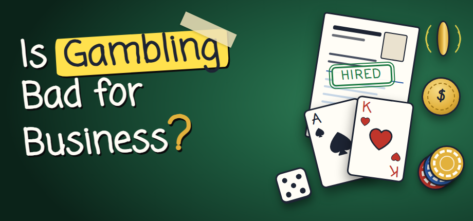
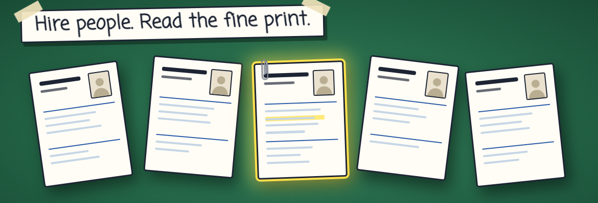
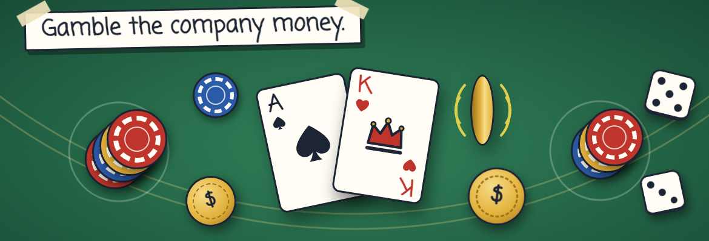
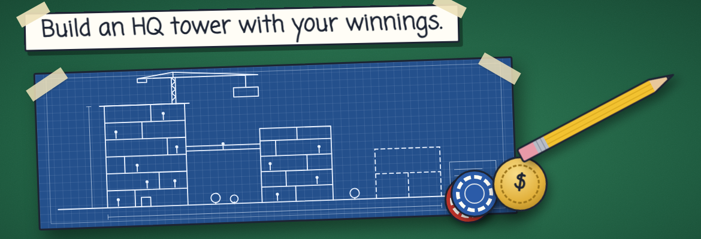
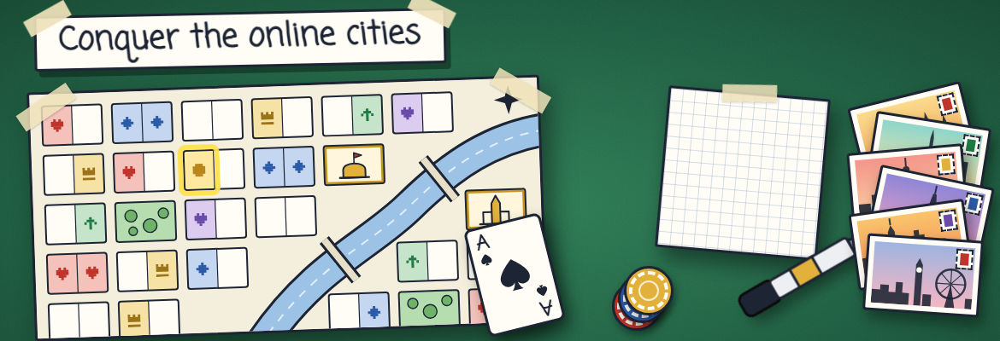

# Is Gambling Bad For Business?

**A deadpan office tycoon about a CEO who can't stop betting the company, made in Unity 6.** Hire from CVs, grow the company, build an HQ tower floor by floor, and find out how much risk a business can take before the Board calls a meeting. Construction is paid for with gambling winnings only. Past $1 billion, six online cities open, where you buy land and win other players' plots at blackjack.

**Coming soon to Steam in Early Access:** [store page](https://store.steampowered.com/app/4427670/Is_Gambling_Bad_For_Business/)

| | |
|---|---|
|  |  |
|  |  |

---

## Gameplay

- **Hire people, read the fine print.**
  - Every applicant comes with a CV: degree, major, personality traits and what they'll likely earn you per day.
  - Hiring tasks ask for exactly the right person, and staff files show who pays for their desk.
  - Firing costs 30 days' salary in severance, and the office has a hard capacity limit: when it's full, you need more floors.
- **Gamble the company money:** coin flips, blackjack and slots.
  - Every bet raises the **Heat**. Run hot and the auditors notice, staff morale drops and the Board's trust drops with it.
  - After a bad loss while the company runs hot, the game asks one question: *"Win it back?"*
- **Build the HQ tower:** a side-view tower of floors and rooms (offices, break rooms, meeting rooms, server rooms, a trading floor, a casino room), each furnished and upgraded. Employees move in as little figures at their desks. Construction is paid for with gambling winnings only.
- **Handle the crisis:** 20 crisis minigames on an old beige CRT (safe cracking, keypad codes, whack-a-mole, math blitz, pattern memory and more) decide what a disaster costs. Nearly 600 risk cards make you choose between playing it safe and going big.
- **Run the company:**
  - **Board meetings** every 10 days, with a Safe, Stretch or Moonshot target. Miss too often and the Board restructures you.
  - **A manager**, picked from three candidates on day 5, who brings you real decisions, gives advice by personality, expects to be paid and can quit.
  - **91 skills**, a **stock market**, and **promotions** from Start-up to Billionaire.
- **Bankruptcy is final.** At $0 you face a hearing: take a loan, bet everything on one last coin flip, or close the doors. The save goes with the company. Reach **$10 billion** and you win as a High Roller.
- **The online cities:** at $1 billion, London, New York, Tokyo, Istanbul, Dubai and Shanghai open, each its own world shared with real players.
  - Buy unclaimed land, draw a pixel-art logo, and put your company's name on the skyline. Land earns rent.
  - Owned land can only be won: stake 1.5 times what the owner paid and play them at blackjack. A plot that just changed hands is protected for 24 hours.
- **Five languages:** English, Simplified Chinese, Japanese, Korean and Turkish, with a handwritten font for each.

*No real money is involved.*

## Status

- **The Steam page is public** (Early Access, coming soon). The full single-player game plays from the first hire to a $10 billion win or bankruptcy, the online cities run on Unity Gaming Services, and saves sync to the cloud with the player's Steam account.
- **A demo** is built into the game (`Demo/`), with a SteamPipe kit for uploading it.
- **Planned for Early Access** (about 12 months):
  - a bigger HQ (new building types, skybridges, outdoor items, exteriors, room styles);
  - 200 to 300 manager situations (about 50 today);
  - more risk cards, crises and events;
  - balance from player feedback, and online cities tuned with real players;
  - native-speaker-checked translations, plus Traditional Chinese.

## Tech stack

| Area | What it uses |
|---|---|
| Engine | **Unity 6** (6000.0.32f1), **HDRP 17** |
| Online | **Unity Gaming Services**: Authentication, Cloud Save, and two **Cloud Code C# modules** (the cloud save server and the online cities server). An access policy denies players any direct Cloud Save write. |
| Platform | **Steamworks.NET**: the Steam account, achievements, the demo |
| Localization | **Unity Localization** with Addressables. The texts live in CSV files, one per table, with an importer, checks and a pseudo-locale. |
| UI | uGUI and TextMesh Pro; UI Toolkit for the online city screens (vector icons drawn with Painter2D, the logo pixel editor) |
| Testing | NUnit suites for both server modules: about 270 tests in 14 files |

## What I built

All of it: **384 C# scripts in `Assets/ScriptsIMade`, about 146k lines**, plus the two Cloud Code modules (1k lines) and their tests (6.8k lines).

| Area | Where |
|---|---|
| The company: applicants and CVs, hiring tasks, staff files, office capacity, events and risk cards, daily economy | `Assets/ScriptsIMade/` (root scripts such as `ApplicantGenerator`, `CompanyManager`, `HiringTaskManager`, `EventManager`), `Staff/` |
| The casino: coin flip, blackjack, slots | `Casino/` (16 scripts), `CoinFlipGame`, `BlackjackGame`, `SlotMachineGame` |
| Heat, the gamble ledger and the "Win it back?" prompt | `Heat/` |
| The HQ tower: build mode, room rules and catalog, blueprints, the tower view | `BuildMode/` (24 scripts, 17k lines) |
| 20 crisis minigames on one base class | `Minigames/` |
| Board meetings; the manager with its situation files, advisor and validator | `Board/`, `Manager/` (23 scripts) |
| Skills, the stock market, promotions | `SkillTreeManager`, `StockMarketManager`, `CompanyManager` |
| Run end: the bankruptcy hearing, the bank loan, game over and the win | `RunEnd/` |
| The online cities: the city screens, map and skyline, the logo pixel editor, the shared city rules | `OnlineCity/` (27 scripts, 11k lines) |
| Saves: the local save, the cloud save sync and its money ledger, the shared save rules | `SaveSystem/` (12 scripts, 9k lines) |
| The server: the cloud save and online city Cloud Code modules, with tests | `GameSaveCCM/`, `OnlineCityCCM/` |
| Localization runtime and the CSV importer; tutorial and feature gates; Steam achievements; the demo mode | `Localization/`, `Tutorial/`, `Achievements/`, `Demo/` |
| Editor tools: UI builders, HDRP lighting setup, the portrait importer, the minigame creator | `Editor/` (43 scripts, 24k lines) |

### Code highlights

- **`OnlineCity/Shared/CityLogic.cs`: every online city operation is written once.** The OnlineCity Cloud Code module compiles the `Shared` folder into the server and runs it against Cloud Save; the game's local test city runs the same code against a file. All money rules are enforced there, on the server.
- **Money stays correct without multi-item transactions** (`CityLogic`):
  - Money a player spends is first set aside in their own account, then the district is saved with a write lock. The district remembers the operation id, so money left behind by a crash is later settled or refunded.
  - Money for other players goes into the district's outbox in the same save. It is then delivered as payouts that each player applies once, so a second delivery never pays twice.
- **Server-checked cloud saves** (`SaveSystem/Shared/SaveRules.cs`, `GameSaveCCM/`):
  - Players can't write Cloud Save at all (`Assets/CloudCode/OnlineCity.ac`). A save only changes in the GameSave module, after `SaveRules` has checked it.
  - The client records the money events since the last accepted upload (`CloudLedger`), so the server can check how the money changed.
  - The rules are pure code with the server's clock passed in, so the Editor's local test server runs exactly the same checks.
- **`OnlineCity/Shared/CityMemoryStore.cs`:** the in-memory city for local play and the tests is stricter than Cloud Save on purpose. A save without a lock only creates and never overwrites, so a missing lock fails in a test instead of online.
- **`Heat/HeatMeter.cs`:** each voluntary gamble adds heat by its stake relative to the company's value (`clamp(2 + 24 × stake / value, 2, 26)`), and risk cards add heat by the card chosen. A day that ends Warm, Hot or On fire costs investor trust, and from Hot also staff happiness.
- **`Minigames/MiniGameBase.cs`:** every crisis minigame runs on unscaled time through the same five phases (warning, setup, get-ready, play, result), so a crisis works while the game is paused. Its completion callback fires exactly once on every path: a win, a loss, giving up, a hidden panel or an error.
- **`Manager/ManagerValidator.cs`:** checks the manager's situation files (effects, targets, conditions, 2–4 choices) in plain C#, from an Editor menu or outside Unity.

## Scenes

| # | Scene | Purpose |
|---|---|---|
| 0 | `Assets/Scenes/SplashScreen.unity` | Splash screen |
| 1 | `Assets/Scenes/Main_Menu.unity` | Main menu |
| 2 | `Assets/Scenes/MainGame.unity` | The game: the office, the HQ tower, the casino and the online cities |

## Integrated third-party assets

| Asset | Used for |
|---|---|
| 80s Brutalist Office, Manager Office, HQ Residential House | Interiors, furniture and props |
| Leartes Studios Cyberpunk Gigapack | A sky HDRI and fog profile, shader graphs and textures, the cable component |
| Kenney Casino Audio, Kenney Interface Sounds | Sound effects |
| Coming Soon, Gaegu, Klee One, LXGW WenKai, Patrick Hand and the city fonts (SIL Open Font License or Apache 2.0) | The handwritten fonts for the UI and each language |
| TextMesh Pro, Steamworks.NET, Newtonsoft JSON | Text, Steam and JSON |

## About this repository

This public repository is a **showcase**. It contains the documentation and the **438 source files I wrote** for this project. The complete Unity project, with the licensed store art it uses, its Unity Cloud link and the Steam store kit, is kept in a private repository.

Copyright © Omer Avcioglu (McHunter Studio). **All rights reserved.** Viewing only; see [LICENSE](LICENSE).
